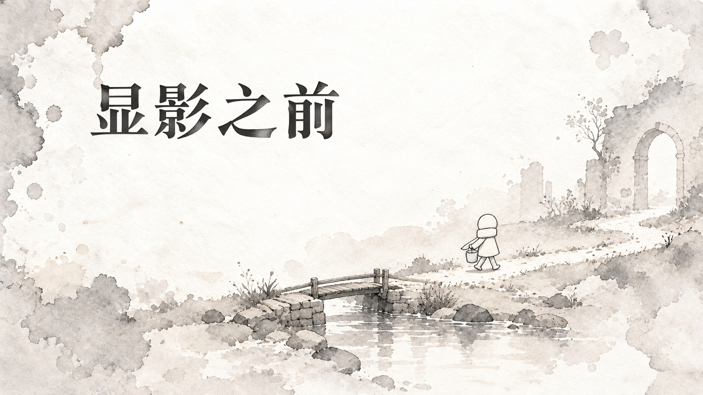
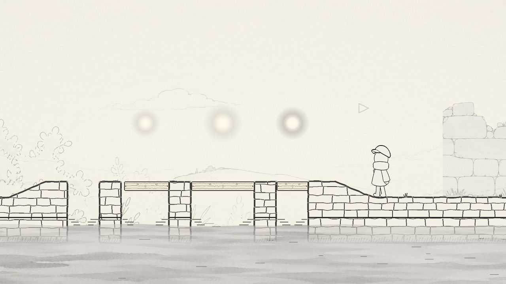

# 显影之前

一笔一画补全旧路，让褪色的风景慢慢显影。

《显影之前》是一款纸面手绘风格的 2D 解谜游戏。拼合水路、补上断线、搬动木板，再走过一扇门。每解开一道谜题，眼前的风景就多显出一点。

这次想做的是一段安静的小旅程：没有复杂的操作，让水、线条和人物的动作带着玩家往前走。游戏用 Godot 和 Java 制作，开发于 2026 年 10 月告一段落。

**[下载 Android 版](https://github.com/nmj111-ada/xianying-zhiqian/releases/tag/android-v1.0)** · **[下载 Windows 版](https://github.com/nmj111-ada/xianying-zhiqian/releases/tag/v1.0)** · [看看开发过程](docs/development.md) · [反馈问题](https://github.com/nmj111-ada/xianying-zhiqian/issues)

## 开始游玩

**Android：**下载 `XianyingZhiqian-Android-v1.0.apk`，在手机上打开并安装。需要 Android 8.0 或以上的 64 位设备，横屏游玩，用手指点击和拖动，系统返回键打开或收起暂停菜单。屏幕较长时两侧会留黑边，保留原来的画面比例。[安装与适配说明](docs/android.md)里写了更具体的步骤。

**Windows：**下载 `XianyingZhiqian-Windows-v1.0.zip`，完整解压到一个文件夹，然后运行 `XianyingZhiqian.exe`。

请保留旁边的 `.pck`、`.dll` 和 `jvm` 文件夹，不要只把 exe 单独拿出来。压缩包已经带上运行环境，不需要另外安装 Godot 或 Java。Windows 版需要 64 位系统。

电脑上主要用鼠标点击和拖拽，`Esc` 打开暂停菜单。谜题会依次出现，可以先观察画面，再试着移动、拼合或连起其中的东西。

## 游戏画面

水路从一张拼图开始。碎片拼合之后，水才有了可以走的方向。

后面的路藏在线条里，需要一段一段把它补出来。

到了河边，线条变成了实实在在的桥。挪动木板，给人物留出落脚的地方。

再往前是回声、砖石门和折页。这里留几张途中画面，结尾就留在游戏里。

| 回声 | 砖石门 |
| --- | --- |
|  |  |

以上是实际游戏截图，页首图片是宣传插画。

## 从原型到现在

早期的桥和门还是灰色的几何块，水路也是另一种样子。后来才逐渐补上纸张、石头、远景和人物动作。有些玩法也在制作中换了方向。

[开发过程里](docs/development.md)放了几张旧画面，和现在的版本对着看，还能认出同一段路。

## 关于这个仓库

这里放游戏介绍、截图、开发过程，以及 Windows 和 Android 下载包，源码暂未公开。反馈时可以在 Issues 写下遇到的问题；如果能附上截图、设备型号，以及问题发生前做了什么，会更容易找到原因。

游戏部分美术素材使用了生成式 AI，标题页也保留了相应标识。[素材与使用说明](docs/usage.md)中写了仓库内容的使用边界。引擎为 Godot，Java 支持来自 Godot-JVM。

[隐私政策](https://nmj111-ada.github.io/xianying-privacy/)
