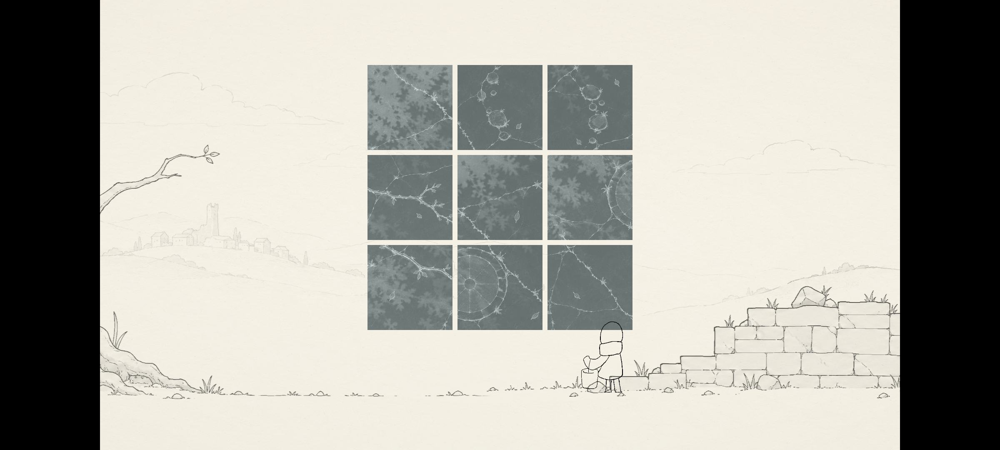

# 在手机上走一走

《显影之前》现在也可以在 Android 上玩了。还是同一段旅程，点击和拖拽换成了手指，画面保持横向。

[下载 Android v1.0](https://github.com/nmj111-ada/xianying-zhiqian/releases/tag/android-v1.0)

## 安装

下载页面中的 `XianyingZhiqian-Android-v1.0.apk`，传到手机上打开。如果系统提示不允许安装，可以在提示页中允许当前浏览器或文件管理器安装应用，安装后再关闭这个权限。APK 自带运行所需的组件，不需要另外安装 Java 或 Godot。

需要 Android 8.0 或以上、支持 64 位应用的设备。包里包含 ARM64 和 x86_64；不提供 32 位和 iOS 版本。

## 操作

轻点按钮，按住并拖动拼图或木板。描线时用手指沿着路径慢慢划过。系统返回键可以打开暂停菜单，再按一次继续。

游戏按 16:9 比例显示，长屏设备两侧留出的黑边属于正常现象。

这张图来自 Android 14 的 x86_64 模拟器。启动、进入首关、触摸拖动和返回键暂停已在该环境检查；ARM64 安装包已经构建并签名，还没有经过实体手机测试。如果碰到显示或操作问题，欢迎在 [Issues](https://github.com/nmj111-ada/xianying-zhiqian/issues) 留下手机型号、Android 版本和出现问题的位置。

游戏不申请网络、电话或存储权限。[隐私政策](https://nmj111-ada.github.io/xianying-privacy/)
