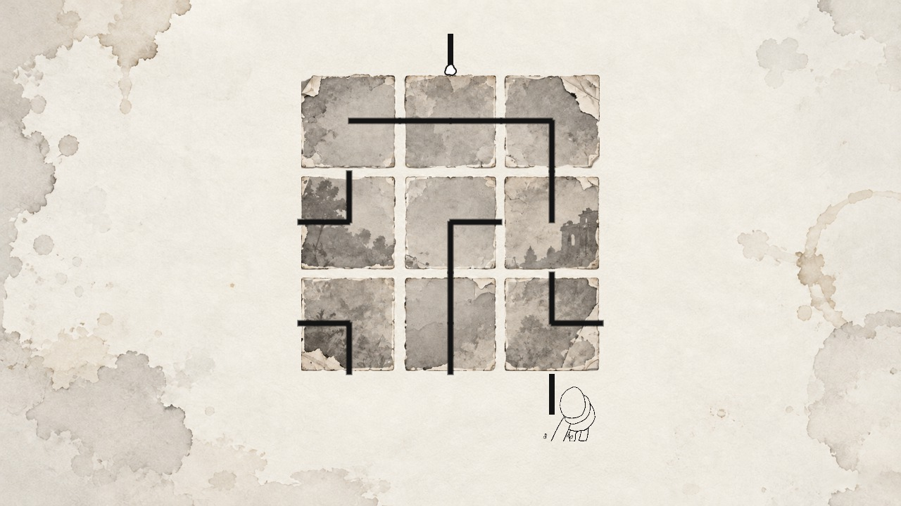
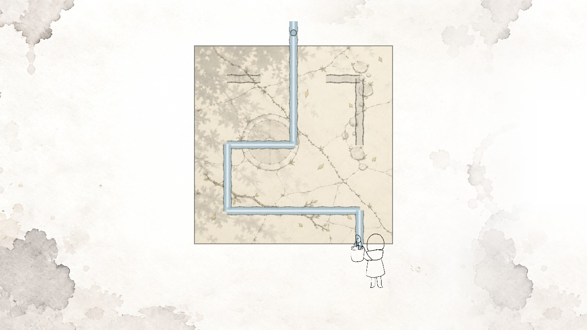
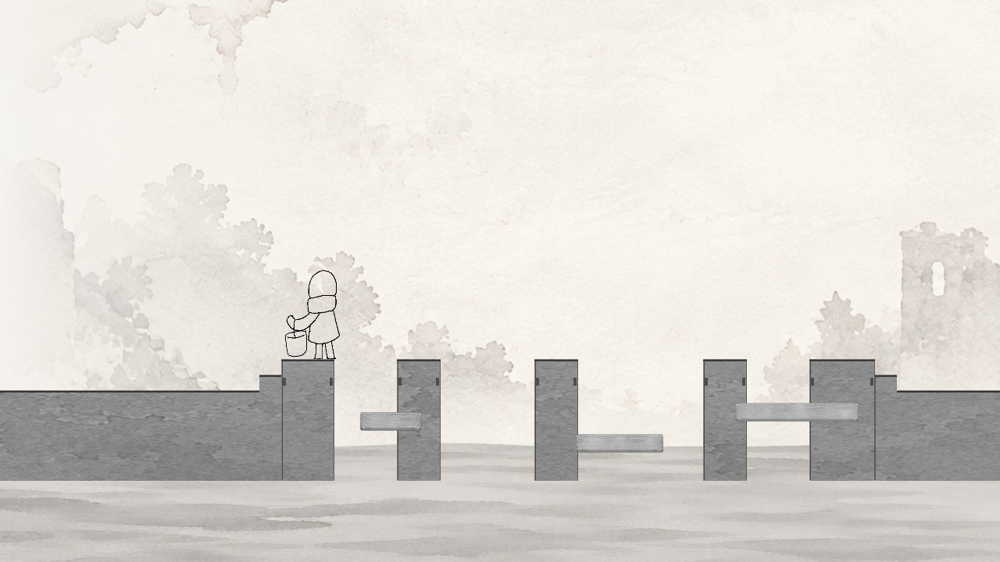
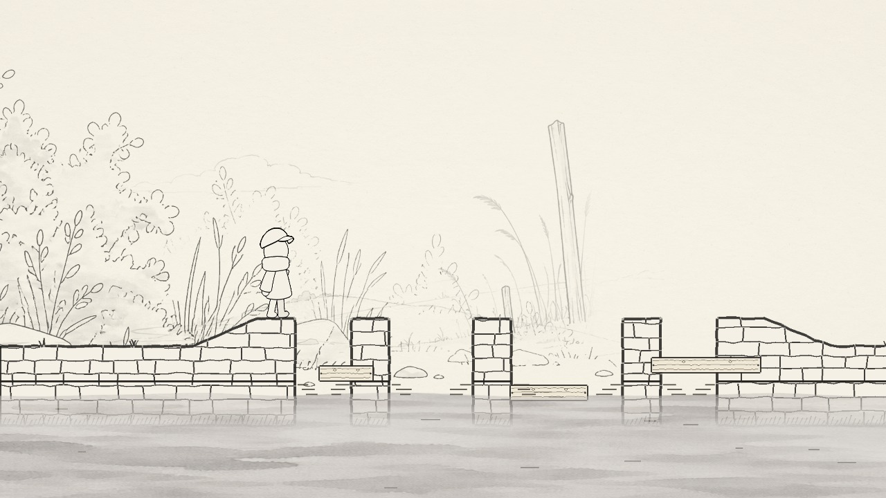
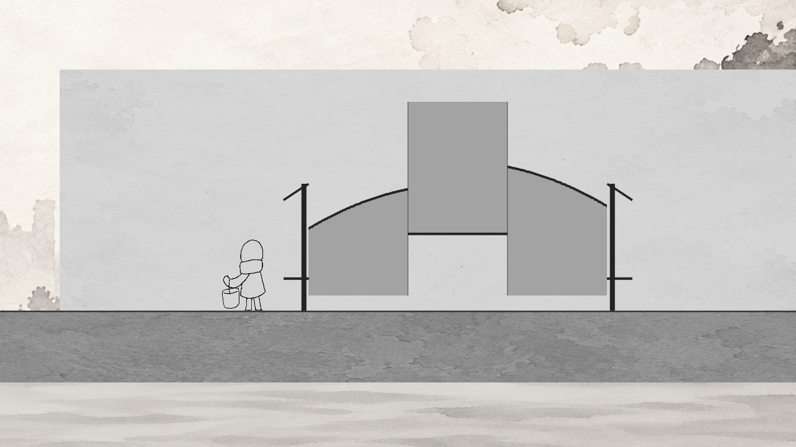
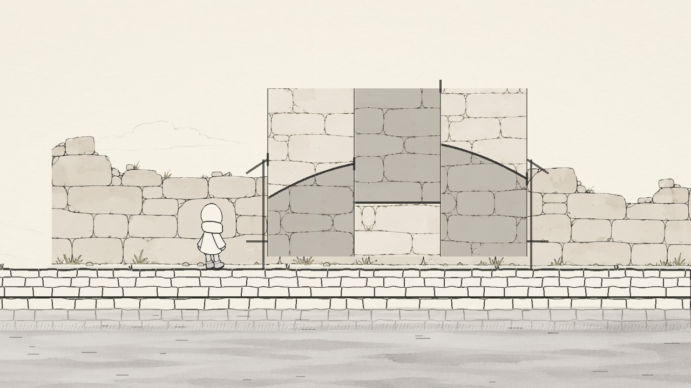
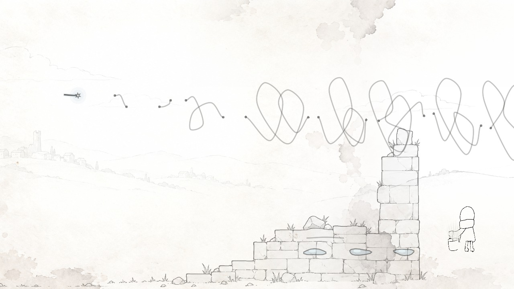
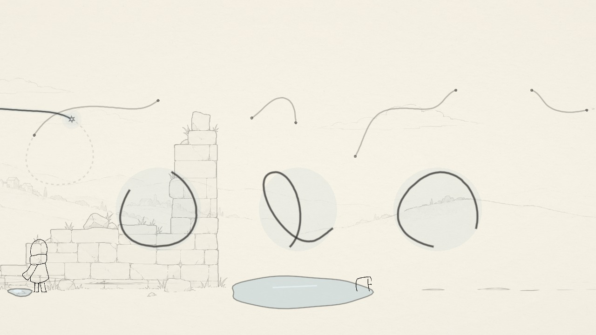

# 路是慢慢画出来的

最早先试的是流程能不能走通：人物停在哪儿，水从哪里来，解开谜题以后怎么继续往前。那时候画面里还有不少灰块，很多动作也只是临时的。

## 水路最初的样子

早期水路的线条更粗，九个格子几乎占满了画面。后来的版本把碎片拼合、显影和引水接在一起，题面也换成了更淡的纸面纹理。

## 先有能走的桥，再有河边的风景

桥的初版用大块灰色表示河岸和桥墩，方便先检查木板能不能放、人物能不能过去。最终画面保留了这套空间关系，再补上石桥、水面、植物和远处的线条。

## 门也曾经只是几块灰板

门洞阶段先把几片墙的位置和遮挡关系搭起来，再逐步换成砖石。站在门前的动作、墙片的移动和门打开的时机，都得放到同一个画面里才能看出合不合适。

## 线条在制作中换过方向

这一版里，道路还是一条很长的乱线，断口沿着线条分布。后面继续调整了题面的组织方式和背景，让玩家更容易分清要观察的部分。

这些是不同阶段留下的实际画面，并不是隐藏关卡。把它们放在这里，是想留住一点制作时的样子。

[回到游戏首页](../README.md)
